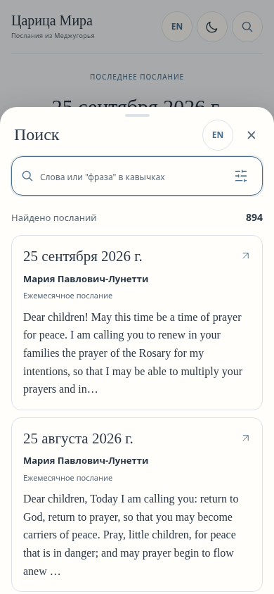
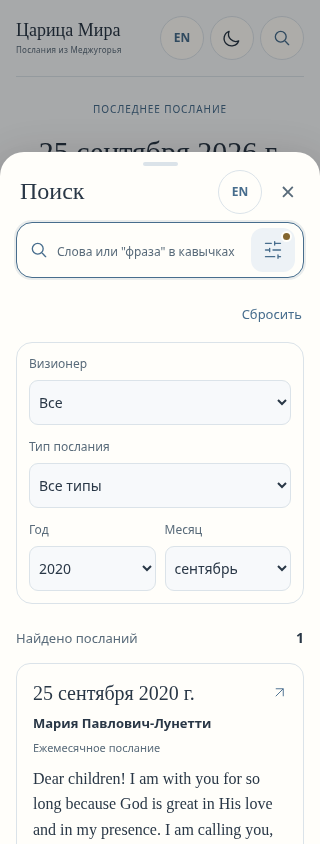

# Поиск в нижнем листе — продолжение #19/#20

Отдельная ветка `feat/search-bottom-sheet` поверх актуального #20 `3ef09d7`. Ранее развёрнутое owner-private C-превью версии 2 **не обновлялось**. #19/#20, D #22, production, main и исходные восемь JSON не менялись; merge не выполнялся.

## Что изменилось

- Постоянная строка поиска удалена с главного экрана. Кнопка с лупой — крайняя справа в верхней панели, рядом с прежними языком и темой.
- Кнопка открывает modal bottom sheet, ограниченный 82dvh; поиск и результаты находятся внутри него. Фокус попадает в строку; Escape, X и Android/browser Back закрывают лист и возвращают фокус кнопке.
- Справа **внутри строки** — inline SVG `sliders-horizontal`. Он раскрывает ровно четыре фильтра: визионер, тип, год, месяц. При обычном новом открытии они скрыты. Маленькая золотистая точка показывает активные фильтры, в том числе при свёрнутой панели; aria-label также сообщает об активности. Сброс снимает фильтры и сохраняет query.
- Компактная кнопка языка в заголовке листа использует прежний диалог независимых языков UI/посланий: язык можно поменять, не теряя текущий поиск.
- Worker и его serial/generation защита не переписаны. Query/фильтры/язык/70 карточек, ID, Back/Forward, deep links и фокус сохранены. `scrollTop` теперь относится к внутреннему scroller листа; чтение по-прежнему сохраняет scroll окна. История не теряет введённый query во время окончания восстановления.
- Ошибка загрузки/retry показывается в самом листе, чтобы scrim не перекрывал кнопку повторения. Темы, шесть имён, pending/unknown и отсутствие молчаливого fallback языка сохранены.

## Скриншоты 320/390 px

Все PNG получены настоящим Chromium из production root build, не макеты. Это viewport-эмуляция; **физический Android и настоящая клавиатура NOT TESTED**.

| Состояние | 320 px | 390 px |
|---|---|---|
| Главная, поиск только в верхней панели | [PNG](../reports/search-sheet/screenshots/home-320.png) | [PNG](../reports/search-sheet/screenshots/home-390.png) |
| Поиск, фильтры скрыты | [PNG](../reports/search-sheet/screenshots/search-collapsed-320.png) | [PNG](../reports/search-sheet/screenshots/search-collapsed-390.png) |
| Раскрыты четыре фильтра | [PNG](../reports/search-sheet/screenshots/a-filters-320.png) | [PNG](../reports/search-sheet/screenshots/a-filters-390.png) |
| Свёрнутые активные фильтры, индикатор | [PNG](../reports/search-sheet/screenshots/search-active-collapsed-320.png) | [PNG](../reports/search-sheet/screenshots/search-active-collapsed-390.png) |
| Тёмная тема с фильтрами | [PNG](../reports/search-sheet/screenshots/search-dark-filters-320.png) | [PNG](../reports/search-sheet/screenshots/search-dark-filters-390.png) |

## Проверки

**PASS локально:** production `build:private`, `check:data`, `check:search-metadata`, 17 Node search tests, 66 Python tests, 5 browser foundation сценариев с настоящим Worker. Полная UI regression — 28 комбинаций 320/390 × семь языков × две темы; без горизонтального scroll страницы и внутреннего листа. [Протокол и 37 PNG](../reports/search-sheet/browser.json).

Дополнительно PASS: нет постоянного query на home; лупа справа; filters toggle внутри input row; 82dvh; filters default hidden; active dot/reset; закрытие Escape/X и фокус; Back/Forward через лист/результат с query/filters/language/70 cards/внутренним scroll/focus; безопасный highlight; быстрые запросы и язык; Worker/archive errors/retry; #archive/#message refresh; missing translation/context; уменьшенный viewport 390×430. Последний проверяет лишь доступное место, не настоящую клавиатуру Android.

Восемь JSON, derived model B и `src/search/` побайтно равны базе #20. Ни один текст или editorial status не изменён. Публикация **NOT RUN**.

## Проверка с телефона

Сейчас открыть эту галерею в GitHub и увеличить PNG 320/390. Живой preview version 2 пока показывает предыдущий C-интерфейс; этот Draft не публиковался.

После отдельного разрешённого обновления приватного превью: Chrome → вход владельцем → лупа справа → ввести слово → sliders-horizontal → выбрать год/месяц → свернуть фильтры (точка остаётся) → открыть результат → Back/Forward (query, filters и позиция восстановлены). Затем Escape/X/Android Back, снова открыть поиск, проверить язык и тёмную тему. Реальный Android/клавиатура/install/offline требуют отдельной проверки на устройстве.

Локальная проверка: `npm run build:private`, затем `npm run test:preview -- --port 5178 --output /tmp/search-sheet-review`. Для стандартного project base — `npm run build` и `npm run test:ui:browser -- --output /tmp/search-sheet-review`.

Основные файлы: `src/App.vue`, `src/style.css`, `src/ui/translations.js`, адаптированный `scripts/check-reader-browser.py`; исходные C-отчёты и галерея сохранены.
