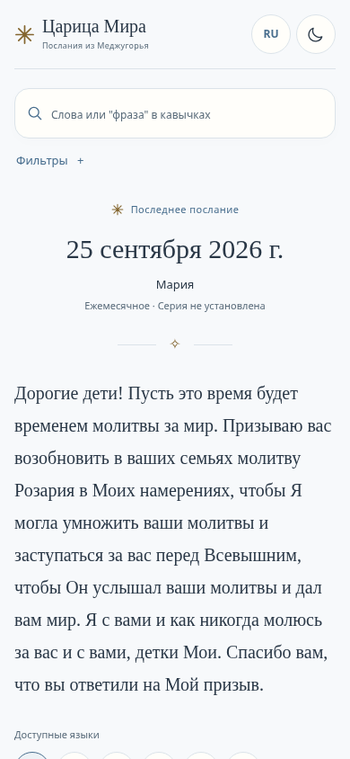
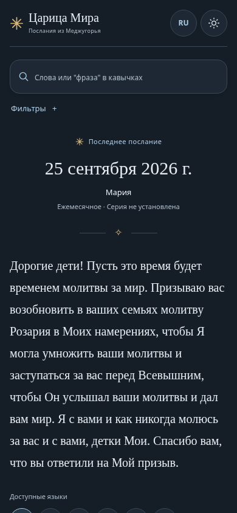
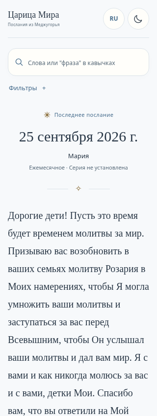
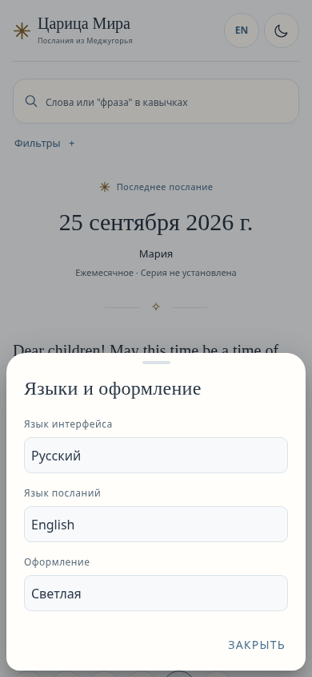
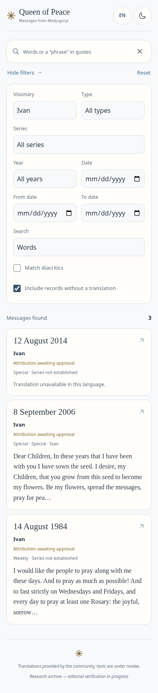
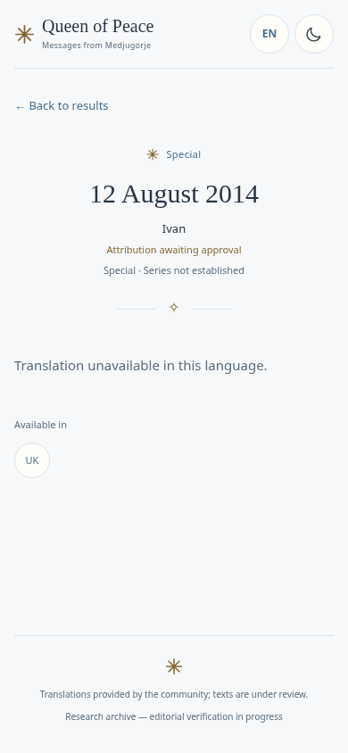
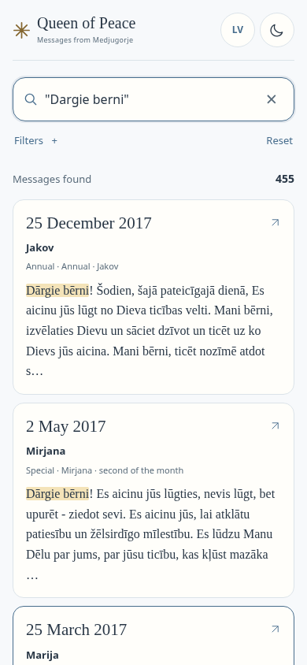
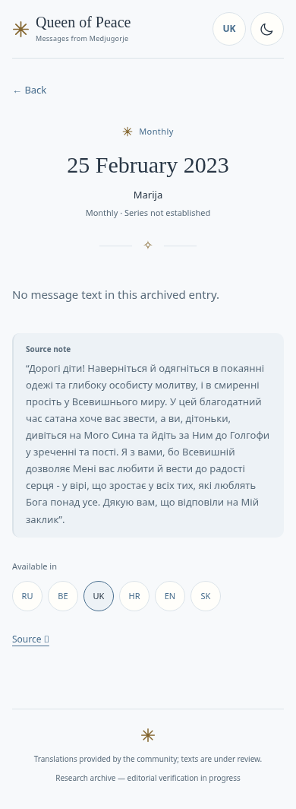
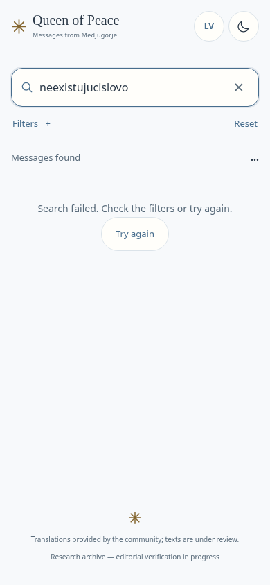

# Скриншоты этапа C для оценки с телефона

Реальный Chromium, production-сборка, локальный адрес. Это статические снимки;
превью и сайт не публиковались. Физический Android и его экранная клавиатура — NOT TESTED.
Полная методика и результаты: [отчёт этапа C](UNIFIED_READER_STAGE_C.md).

## Главный экран · RU · 390 px

Светлая тема:

Тёмная тема:

## Узкий экран · RU · 320 px

## Языки и системная тема

## Фильтры и три pending-записи Ивана

EN по умолчанию показывает две доступные записи Ивана. На снимке включён показ
записей без перевода, поэтому доступны все три. Пометка атрибуции остаётся pending.

## Чтение записи без перевода

ID сохраняется; язык можно выбрать вручную. Автоматической подстановки текста нет.

## Поиск и подсветка диакритики

## Пустой текст и отдельный контекст источника

## Ошибка Worker и повторная попытка

## Все локализации · 390 px

| Язык | Светлая | Тёмная |
|---|---|---|
| Русский | [PNG](../reports/stage-c/screenshots/home-ru-390-light.png) | [PNG](../reports/stage-c/screenshots/home-ru-390-dark.png) |
| Беларуская | [PNG](../reports/stage-c/screenshots/home-be-390-light.png) | [PNG](../reports/stage-c/screenshots/home-be-390-dark.png) |
| Українська | [PNG](../reports/stage-c/screenshots/home-uk-390-light.png) | [PNG](../reports/stage-c/screenshots/home-uk-390-dark.png) |
| Hrvatski | [PNG](../reports/stage-c/screenshots/home-hr-390-light.png) | [PNG](../reports/stage-c/screenshots/home-hr-390-dark.png) |
| English | [PNG](../reports/stage-c/screenshots/home-en-390-light.png) | [PNG](../reports/stage-c/screenshots/home-en-390-dark.png) |
| Slovenčina | [PNG](../reports/stage-c/screenshots/home-sk-390-light.png) | [PNG](../reports/stage-c/screenshots/home-sk-390-dark.png) |
| Latviešu | [PNG](../reports/stage-c/screenshots/home-lv-390-light.png) | [PNG](../reports/stage-c/screenshots/home-lv-390-dark.png) |

[RU 320 dark](../reports/stage-c/screenshots/home-ru-320-dark.png) · [Уменьшенное окно при вводе и пустой результат](../reports/stage-c/screenshots/keyboard-space-empty-390.png).
