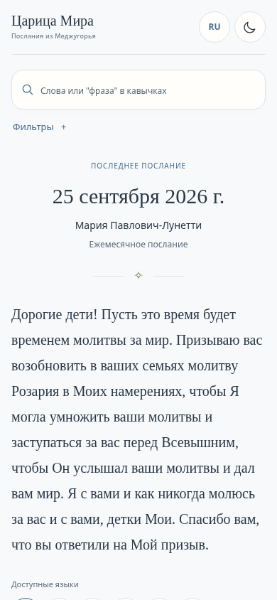
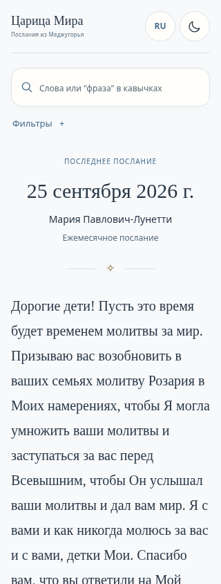
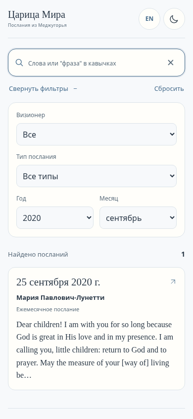
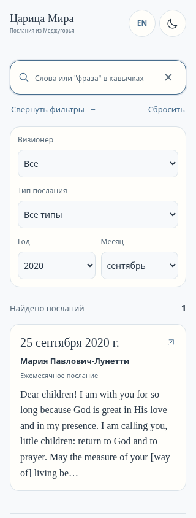
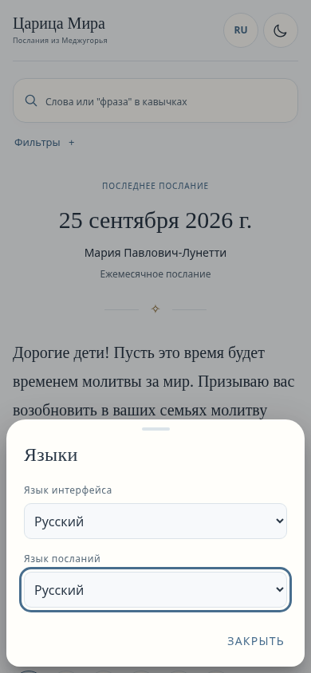
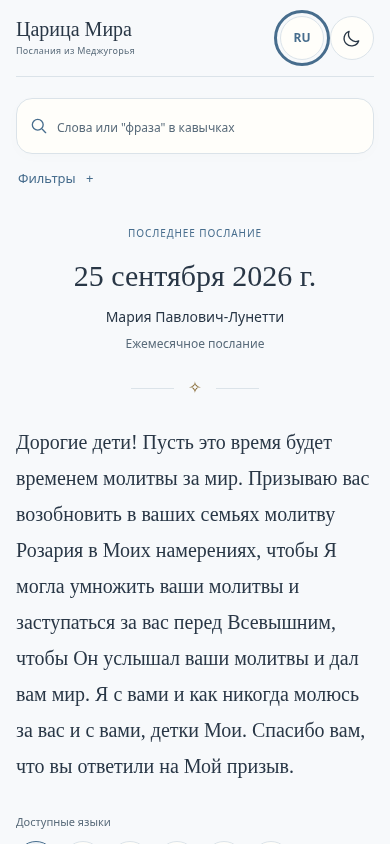
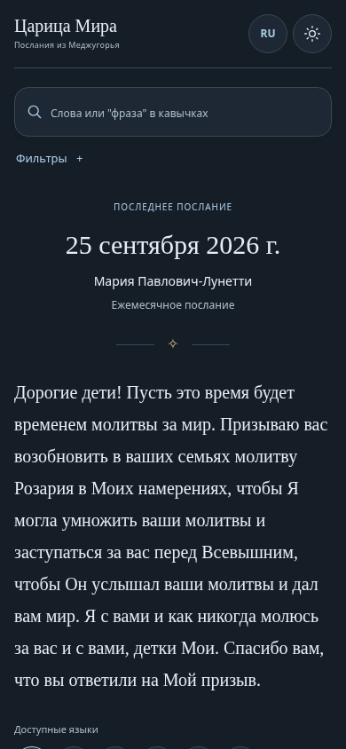
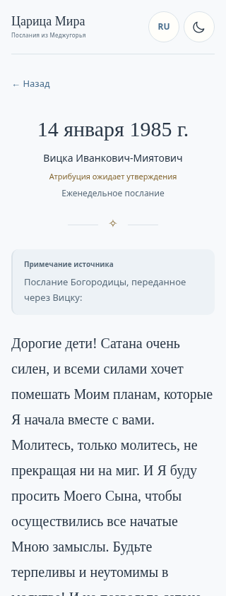
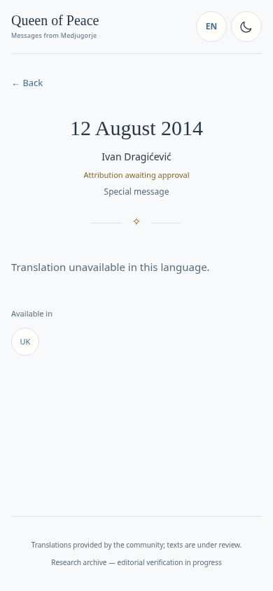
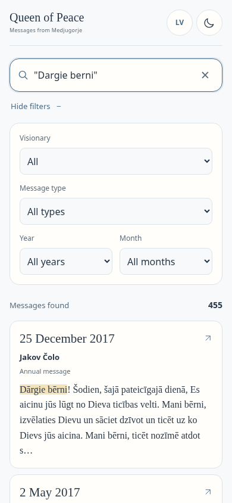

# UX Polish C · реальные скриншоты для телефона

[Отчёт с PASS / FAIL / NOT TESTED](UX_POLISH_STAGE_C.md).
Снимки «до» — сохранённые PNG исходного PR #19 (`2c69a62`), «после» — настоящий
Chromium на production-сборке после polish. Иллюстрации не генерировались,
изображения не редактировались. Публикации превью не было.

## Чтение · 390 px · до

## Чтение · 390 px · после

## Чтение · 320 px · до

## Чтение · 320 px · после

## A · четыре фильтра

[Старая перегруженная панель — PNG](../reports/stage-c-polish/screenshots/before-filters-ivan-390.png).
В новых снимках выбран сентябрь 2020; месяц работает и при «Все годы» — проверено
браузером отдельно. UI — RU, язык посланий — EN: это независимые настройки.

390 px:

320 px:

## B · язык отдельно от темы

[Лист до — PNG](../reports/stage-c-polish/screenshots/before-language-sheet-390.png).
Теперь в нём только два языка:

Светлая тема:

Тёмная тема:

[Лист 320](../reports/stage-c-polish/screenshots/b-languages-320.png) ·
[Светлая 320](../reports/stage-c-polish/screenshots/b-light-320.png) ·
[Тёмная 320](../reports/stage-c-polish/screenshots/b-dark-320.png).

## C · длинное полное имя и редакционный статус

## Корректный пропуск перевода

## Поиск с диакритикой

## Семь языков · 390 px

| Язык | Светлая тема | Тёмная тема |
|---|---|---|
| Русский | [PNG](../reports/stage-c-polish/screenshots/after-ru-390-light.png) | [PNG](../reports/stage-c-polish/screenshots/after-ru-390-dark.png) |
| Беларуская | [PNG](../reports/stage-c-polish/screenshots/after-be-390-light.png) | [PNG](../reports/stage-c-polish/screenshots/after-be-390-dark.png) |
| Українська | [PNG](../reports/stage-c-polish/screenshots/after-uk-390-light.png) | [PNG](../reports/stage-c-polish/screenshots/after-uk-390-dark.png) |
| Hrvatski | [PNG](../reports/stage-c-polish/screenshots/after-hr-390-light.png) | [PNG](../reports/stage-c-polish/screenshots/after-hr-390-dark.png) |
| English | [PNG](../reports/stage-c-polish/screenshots/after-en-390-light.png) | [PNG](../reports/stage-c-polish/screenshots/after-en-390-dark.png) |
| Slovenčina | [PNG](../reports/stage-c-polish/screenshots/after-sk-390-light.png) | [PNG](../reports/stage-c-polish/screenshots/after-sk-390-dark.png) |
| Latviešu | [PNG](../reports/stage-c-polish/screenshots/after-lv-390-light.png) | [PNG](../reports/stage-c-polish/screenshots/after-lv-390-dark.png) |

[Уменьшенное окно и пустой поиск](../reports/stage-c-polish/screenshots/d-keyboard-space.png). Это не снимок клавиатуры Android. Физическое устройство — NOT TESTED.
